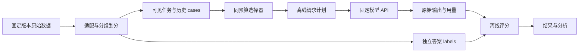

# 项目架构 工具选择与实现路线

## 1 推荐技术组合

| 层面 | 现在建议 | 为什么 | 何时增加其他工具 |
|---|---|---|---|
| 主开发语言 | Python 3.11 或 3.12 | 数据、模型接口和主流 Agent 基准生态一致 | 暂不增加第二门语言 |
| 编辑与版本管理 | VS Code 或 PyCharm 加 Git | 调试、版本固定和差异审查 | 与现有习惯一致即可 |
| 环境 | venv 或 uv | 项目依赖独立，便于复现 | 需要环境迁移时锁定版本 |
| 数据格式 | JSONL 加 JSON manifest | 可逐行检查、落盘和追踪，不依赖服务 | 数据量大再用 Parquet/DuckDB |
| 模型接口 | 一层简单 API adapter | 固定提示、调用次数和用量容易审计 | 模型数量增加后考虑 LiteLLM |
| Token 计数 | tiktoken 或模型原生 tokenizer | 明确预算口径 | 不用字符数冒充 token |
| 检索基线 | 透明 BM25 实现 | 无训练、低成本、能解释 | 增加 BGE 等 embedding 作为强对照 |
| 轻量效用预测 | scikit-learn | 先验证标签是否可预测 | 瓶颈明确后才用 PyTorch/Transformers |
| 本地模型服务 | 暂不需要；有合适 GPU 后用 vLLM | 初期调用 API 即可验证 | 大规模重放成本支持本地部署时 |
| 统计与绘图 | pandas、NumPy、SciPy、Matplotlib | 表格、配对置信区间和论文图片 | 不需先搭仪表盘 |
| 实验记录 | 本地 JSONL、配置、commit/hash | 起步透明且无外部账户依赖 | 实验量大后接 MLflow 或 W&B |
| 交互实验环境 | AppWorld 优先，ToolSandbox 备选 | 有执行状态和自动评价 | 静态现象稳定后再接入 |
| 论文写作 | Zotero 加 Overleaf/本地 LaTeX | 文献管理和会议模板成熟 | 初期中文设计继续用 Markdown/Word |

当前核心包以 Python 标准库为主，研究组件使用 NumPy、scikit-learn、tokenizers，依赖已写入 requirements-lock.txt。本机实际使用 Python 3.14.6，跨平台迁移需检查兼容性。DeepSeek 专用接口、SQLite 活动账本、效用训练器、统计报告与防护均已实现；最新模块表和阶段状态见 README。

## 2 为什么暂时不用大型 Agent 框架

初期研究变量是历史选择器，不是整个 Agent 编排。LangChain/LangGraph 可以用于后续应用系统，但不是这项实验的必需品。手写一个清楚的“选择历史→组装提示→调用模型→记录→评分”循环，能直接控制 token、恢复和调用次数。

同样暂时不需要向量数据库、Neo4j、Redis、多 Agent 协调、Web 前端或强化学习训练平台。候选关系先用 Python 邻接表即可。若最终研究需要这些组件，再用实测瓶颈说明引入原因。

## 3 核心数据流



选择器与 API 执行器只接收 cases 或 requests。答案只由离线评分器读取。训练阶段另设干预数据生成流程，测试阶段不连接这个标签通道。

## 4 模块接口

`Case` 包含 id、当前问题、工具定义、历史块、组 ID、划分；没有答案或证据标签。历史块保留原始消息内容，以一个用户轮次及其后助手/工具消息为原子块。第一版不拆断工具调用与返回关系，但可能因块太大而无法装入预算；正式实验需做分块粒度消融。

`Budget` 对最终历史 JSON 文本统一计数，包含 ID 和边界字符。按固定顺序序列化，避免方法靠改变文本顺序获得未控制的收益。

`select(case, method, budget)` 返回原始证据子集。recent 是最近优先，bm25 是相关性优先，rule_pairs 是词面关系补齐。摘要基线已由 campaign 拆成生成与执行两个阶段，分别持久化并计入成本。

`utility(S)` 在真实活动中接入 train 组训练的 Ridge 模型；`guards.py` 检查采样支持范围与验证收益，不可靠时回退 BM25。首轮原模型未通过检查，旧结果保留。合成实验仍可传入已知目标；测试金标准不能通过闭包传进选择器。

`make_plan` 固定随机种子、预算、重复次数与方法，生成不可覆盖的计划目录。完整历史参考每题每次重复只运行一次，不重复计入每个预算。

`ChatClient.complete` 只负责一次请求与用量，`score` 只负责离线评价。这样更换服务不必修改实验选择逻辑。

## 5 后续目录如何扩展

以下是后续按规模拆分的目录建议，不表示每个目录已创建。目前学习、统计、报告在 utility.py、statistics.py、reporting.py 中实现；AppWorld 适配与论文源码尚未实现：

```text
src/context_bundles/
├── adapters/          # appworld.py toolsandbox.py 与状态恢复
├── utility/           # 干预标签 特征 训练 校准 条件集合效用
├── candidates/        # schema 实体链接 引用链以及其诊断
├── baselines/         # 普通摘要 强方法复现或明确适配版本
├── analysis/          # 分组 bootstrap 交互分解 成本曲线
└── reports/           # 从冻结结果生成论文表格和图
paper/
├── main.tex           # 确定投稿目标后使用官方模板
├── sections/
├── figures/           # 全部由实验数据脚本生成
└── references.bib
```

不要先创建一堆空模块冒充完成。阶段达到时再实现，保持 README 中状态表准确。

## 6 实现顺序与验收

| 阶段 | 交付物 | 验收条件 |
|---|---|---|
| M0 当前工程底座 | 下载、适配、预算、基线、请求、接口、评分、测试 | 可用真实格式数据离线走完；无标签进入请求；无预算超限 |
| M1 数据与现象检查 | 完整快照、10 个审核案例、四条件模型结果 | 来源可靠，重复结果稳定，长度/位置/评分门槛混杂得到检查 |
| M2 小规模比较 | 预先抽样的开发任务，多个预算和简单基线 | 确认同成本收益及负结果；若规则已足够则简化方法 |
| M3 学习和搜索 | 条件效用训练、候选诊断、强基线 | 候选、预测、搜索收益可以拆开解释；测试组冻结 |
| M4 交互验证 | AppWorld 执行与统一恢复 | 同状态可重放，主指标为任务完成，包含完整成本 |
| M5 论文与发布 | 冻结实验、统计区间、图表、论文、复现脚本 | 每个主要主张有对应实验；无把假设写成结果 |

每个阶段先过验收再扩展。M1/M2 不支持互补主张时可以停在诊断研究，不为了已写好的题目勉强训练模型。
