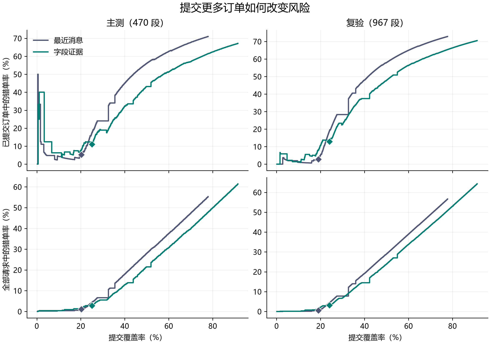

# 有限历史预算下的购票参数恢复：参考标签、采集模板与错单代价

**摘要**　工具型助手可以优先保存最近消息，也可以从较早的对话中选取含有订单参数的原话。即使后一种方法与参考订单匹配得更多，增加的提交是否符合用户意图，仍取决于参考标签质量和提交策略。本文在 TicketTalk 上固定调用位置、128 token 历史预算和参数读取器，比较消息选择方法，并分别记录正确写入、错写和未提交。在修正对话时序后的 470 个主测对话和 967 个复验对话中，字段证据选择比最近消息分别多匹配 13 单和 22 单，同时多写错 14 单和 27 单。按原始采集场景聚类，正确率差的两个 95% 区间均跨零；将最终确认的场次用于敏感性评分后，复验两种方法均匹配 186 单。限制可选座位的写入依据，在不改变提交数的条件下分别减少了 4 个和 7 个字段选择方法的错单，但漏填座位也增加。本文给出对话级和场景级统计、风险—覆盖率曲线、独立检索与读取器对照以及可复查的盲审样本，为解释压缩后的订单匹配率提供依据。

**关键词**　对话历史选择，工具参数恢复，标签噪声，选择性预测，错单风险

## 1　研究问题

在购票对话中，助手可能先列出下午 4:30 和晚上 9:10 两个场次，再询问人数和座位。用户最后一句“对”只有与之前的确认问句结合，才说明最终选择。更多上下文既可能找回人数，也可能重新引入已放弃的场次。另一个问题来自监督信号本身：如果参考调用写入 4:30，而用户明确确认了 9:10，学习参考订单和识别用户选择会得到不同的最优输出。

我们研究给定购票工具与调用位置时，固定历史预算的消息选择如何影响完整参数恢复。研究围绕三个可检验的问题展开。首先，参考订单匹配率的提升能否在不同采集场景复现？其次，标签来源和下单门槛如何改变方法排序？最后，额外付出的计算时间换来了哪些字段上的收益和损失？实验还给出一种针对可选座位字段的低成本修正，直接量化有依据地提交和漏填之间的取舍。

## 2　相关工作

SOM-DST [1] 以选择性覆盖维护跨轮槽位，DiCoS-DST 和 DNQS-DST [2,3] 按槽检索相关话轮。Park 等 [4] 在紧预算设置中考察了出现参数值的消息与最终确定该值的消息，并比较多种保留策略。TicketTalk [5] 提供购票语料及 API 调用目标。本文关注同一个读取器在有限预算下最终提交了哪些订单，并比较记录匹配、确认依据和提交代价三种评价角度。我们实现了冻结的 MiniLM 语义检索及其与近因排序的融合；这里的直接对照尚未覆盖 Pivot、SOM-DST 或 DiCoS-DST 的完整原模型。

## 3　数据与方法

**还原输入。** TicketTalk 的 TSV 把当前发言编码在分隔符 `<C>` 前面，把此前的对话按时间顺序放在它后面。我们按带引号的 TSV 规则读取字段，以分隔符前的用户话语为当前请求，只将后段的用户、助手发言纳入可压缩历史。排除当前为工具返回、缺少参考必填字段等不满足本任务条件的样本。初版实现把当前答复放到了历史开头，又把历史末尾的助手提问当作当前请求，并遗漏了部分带引号的记录。本修订使用修正后的输入重新训练和评分，旧稿中的 +5.08 和 +3.30 个百分点已撤回。

训练集取官方训练分片 aa–ad 中 1,970 段购票对话，共有 98,342 个词表匹配的候选提及。开发分片 aa 的 492 段对话按规范化历史指纹划分，245 段用于拟合整单置信度模型，247 段用于策略选择。主测取测试分片 aa 的 470 段，复验取开发分片 ab–ac 的 967 段。按对话 ID 和标准化历史文本去重，并延续先导研究对已查看样本的排除规则。本次修订的分析属于回顾性复评，两批样本共享电影票业务和采集流程。场景折外实验另将同一原生场景从训练与校准同时排除。

**基线与字段选择。** 最近消息法从后向前选取仍可装入预算的完整发言。BM25 及 MiniLM 语义检索使用当前请求检索历史，融合基线结合语义与近因排名。字段方法在训练调用中学习候选词表，用逻辑回归给每个字段和值在原话中的提及打分。输入包含说话者、距当前轮的距离、候选左右词、同字段歧义、以及确认和修正措辞。监督标签来自最终参考调用。对每个字段取全历史下的最高分候选，若某条消息能将该候选在已选集合中的最高支持从 m 提高至 h，则其增量为该候选得分乘以 max(0, h − m)。逐步选取跨字段增量最高且预算容纳的消息，并列时优先较近者。所有主对照共用候选读取器、词表、下单规则和分词器。历史原文连同消息编号及 JSON 包装一并计入 128 token，当前用户话语另行提供。

**提交与风险。** 必填影片、影院、场次齐全，且整单置信度达到阈值时，在重置的 SQLite 表中插入订单。参数的字段集合和字符串值全部等于参考记为正确，写入而有差异记为错写，未插入记为未提交。统一阈值为 0.5；可选字段原先仅用字段置信度门槛。新增座位规则要求保留的原话中有座位依据，例如用户明确提及座位及拟填值，或能看到助手提议与紧邻用户肯定。高置信值仍可能因缺乏这类证据而省略。

提交覆盖率以全部请求为分母，条件错单率以已提交请求为分母。令错写、未提交、正确的损失分别为 λ、1、0，则每请求损失等于 (λ × 错写数 + 未提交数) / 请求数。对两种方法采用相同的座位规则和选阈值程序，在开发数据上分别最小化对应损失，最后评估锁定的阈值。文中 λ 代表假设的业务偏好。

## 4　结果

### 4.1　强基线、提交结果与方法消融

表 1　同一学习读取器、128 token 历史与 0.5 提交阈值。每格为正确 / 错写 / 未提交的订单数。

| 历史选择方法 | 主测（470） | 复验（967） |
|---|---:|---:|
| 最近消息 | 93 / 7 / 370 | 186 / 11 / 770 |
| BM25 | 60 / 10 / 400 | 127 / 17 / 823 |
| MiniLM 语义检索 | 10 / 3 / 457 | 14 / 14 / 939 |
| MiniLM 与近因排名融合 | 42 / 5 / 423 | 83 / 12 / 872 |
| 含候选值的消息优先 | 93 / 7 / 370 | 184 / 8 / 775 |
| 字段证据选择 | 106 / 21 / 343 | 208 / 38 / 721 |
| 去掉边际更新 | 106 / 9 / 355 | 204 / 24 / 739 |
| 完整历史（不限预算） | 77 / 5 / 388 | 141 / 11 / 815 |

语义与词项检索在这一任务上提交较少，当前用户答复常为简短同意，因而查询本身可能缺乏电影及影院信息。字段方法与最近消息相比，官方正确率分别增加 2.77 和 2.28 个百分点，错写率分别增加 2.98 和 2.79 个百分点。去掉边际更新后主测正确数持平、错单少 12 个；复验少 4 个正确订单，也少 14 个错单。改为优先较早消息打破并列，对应结果为主测 107 正确、20 错写，复验 207 正确、42 错写。可选字段阈值从 0.3 改为 0.7 时，两批正确数从 105、205 变为 109、215，错单也从 19、36 增至 28、41。方法本身和是否提交共同影响这项指标，复杂的贪心更新没有显示出一致必要性。

### 4.2　采集场景、对话长度与多重比较

每段主测、复验对话分别对应 37 和 38 个原生采集场景。按对话重采样，正确率差的 95% 区间为 [0.85, 4.68] 和 [1.03, 3.52] 个百分点；按原生场景整组重抽 20,000 次后，区间扩大为 [−0.79, 10.03] 和 [−1.43, 9.57]。对两个队列的正确、错写四项场景配对检验进行 Holm 校正后，正确数的两项 p 值均为 1，错写的两项分别为 0.0081 和 0.00018。其余多项分组和消融是探索性结果。场景比较需要独立场景及零假设下整体交换方法标签的假定。

一个与影院名称差错有关的模板，在主测 14 段对话中贡献净增 13 个正确订单，在复验 29 段中贡献 28 个。单独删去该模板，主测其余对话的净增变为零，复验其余对话少匹配 6 单。按公开消息数分组，13–20 条消息组两批分别多匹配 15 和 26 单，21 条及以上组分别少匹配 2 和 4 单。将原生场景按哈希分五折，每次从词表、提及模型和校准器中排除待评折再预测，主测最近消息与字段方法分别正确 55 和 52，复验分别正确 111 和 93。排除场景也减少训练量；两次对照均无法证明字段方法在新的采集场景上有稳定匹配优势。

### 4.3　标签可靠性与训练敏感性

我们从初稿已有的 1,391 个评测对话中按带盐哈希预选 48 条，向独立判读流程只显示对话，先锁定场次及支持原话，再关联参考订单。判读者为一个知晓本项目研究问题的模型，未完成双人人工裁决。38 条与官方场次相符，7 条明确冲突，3 条官方时间缺少上午或下午标记而无法判定。7 条冲突均为确认晚 9:10、参考下午 4:30。明确冲突占 7/48，Wilson 95% 区间为 7.25%–27.17%；条件于 45 条可比较样本为 7/45。将 3 条含糊记录分别算作一致及冲突，样本中可能比例为 14.58%–20.83%。这个估计针对旧队列、场次字段与此次模型判读。预先定义的窄规则在这批样本仅检出了 7 个明确冲突中的 3 个。

训练过程另设两种干预。从 1,970 段训练对话中，规则能对照用户确认与官方场次的有 830 段，排除其中 140 个冲突对话后重训。另一次随机排除同样数量作为对照，整单校准流程相同。全量训练时，复验的官方正确数为最近消息 186、字段方法 208；排除冲突训练样本后为 183、177；随机排除后为 186、210。训练标签和相关模板的构成都能改变排序。简单删样还会丢失与实际需求有关的语言多样性。

保持全量训练的预测和提交决策固定，仅对检测到明确冲突的评测样本，以用户确认时间替换场次进行敏感性计分，其他字段仍依照原参考。主测最近与字段方法的正确 / 错写分别为 93 / 7 和 96 / 31；复验分别为 186 / 11 和 186 / 60。对未被规则检出的冲突，分数仍可能有偏差。双人独立编码数据包、待裁决表和一致性统计工具均随项目提供，当前结论没有使用人工一致率。

### 4.4　风险、覆盖与可选字段

表 2　座位依据规则固定提交数时的变化。各列中的箭头为同一方法应用规则前后。

| 批次及方法 | 已提交 | 正确数 | 错单数 | 座位多填 | 座位漏填 |
|---|---:|---:|---:|---:|---:|
| 主测 · 最近 | 100 | 93 → 93 | 7 → 7 | 0 → 0 | 5 → 7 |
| 主测 · 字段 | 127 | 106 → 110 | 21 → 17 | 5 → 0 | 11 → 17 |
| 复验 · 最近 | 197 | 186 → 184 | 11 → 13 | 0 → 0 | 8 → 11 |
| 复验 · 字段 | 246 | 208 → 215 | 38 → 31 | 12 → 0 | 19 → 27 |

图 1　按置信度调整阈值得到条件错单率和总体错单率。每个点保留并列的全部提交，零提交时条件错单率无定义。菱形表示按开发集假定代价选择的阈值。

在 λ=2 且启用座位规则时，开发集选择的最近消息阈值为 0.60、字段阈值为 0.55。每请求损失差（字段减最近）在主测为 −0.028，复验为 −0.017。若把阈值视为固定，仅按评测对话重采样，则两个区间都低于零。同时对开发、评测对话重采样，每次重新选阈值，两个区间扩大为 [−0.051, +0.009]、[−0.035, +0.018]。采用 λ=5 或 10 的座位规则时，相应双样本区间亦包含零。当前数据给出了随使用方代价变化的候选策略，尚不足以确定稳定的线上操作点。

### 4.5　读取器、系统开销与跨业务范围

在修正后的 470 个主测对话中，按固定哈希抽取 96 个，复用最近消息及字段方法各自选中的原话，交给本地 Qwen2.5-1.5B-Instruct（Q4_K_M）独立生成订单。提示、解码种子和温度 0 固定，不使用训练词表或原整单置信度。三项必填字段同时与参考匹配的对话从 36/96 变为 41/96，完整订单严格匹配从 0/96 变为 3/96。两个分支都写满了 96 单。严格字符串和可选字段是重要限制；小型量化生成模型的这个结果只能用于检查对读取器的依赖，尚不能推广至更强模型或可信的自主提交。

在 Intel Core i7-14700HX 上抽取 64 段对话，测量模型已加载但本请求无缓存时，从输入解析、确定保留的消息到参数推断、校准及 SQLite 写入的单请求耗时。最近消息、字段方法和 MiniLM 语义检索的中位数分别为 4.75、6.65 和 157.55 毫秒，第 95 百分位分别为 6.81、8.75 和 211.02 毫秒。BM25 的中位数 / 第 95 百分位为 4.78 / 6.60 毫秒；稠密加近因融合为 161.33 / 220.60 毫秒。相同请求立即重复时，稠密检索的中位数降为 4.69 毫秒，字段方法为 6.41 毫秒。编码器加载另需约 1.01 秒。该测量未包含生成式模型推理、真实服务网络或支付处理。

跨语料诊断使用免训练的公开字段规则，各方法共享同一个读取器。此前未用于初稿选参的 MultiWOZ 2.2 开发对话中，字段恢复由 16/932 增至 61/932，绝对正确率仍低。在 SGD 上另锁定八个新文件，筛查 1,024 段，保留来自六个服务的 390 段含分类目标的调用。最近与字段方法各正确 145 段，各有 3 段独自答对，差值的配对 95% 区间为 [−1.28, +1.28] 个百分点。这些是新增对话，相关服务在此前项目的其他分片出现过。本实验使用已知服务和意图来恢复分类字段，不代表购票监督模型直接迁移至六种业务。

## 5　讨论与结论

对整单的严格匹配既会把错误标签当成正确目标，也会将拼写差异、多填或漏填视为整单失败。我们以公开参考、确认场次和训练删样三个角度量化这种依赖，以错写代价和场景折外分析检验结论的适用范围。字段选择在同业务、同阈值下能提高官方匹配率；在按采集场景隔离重训、按用户确认复核或加重错单代价时，收益缩小、消失或反转。带座位依据的提交规则是一项可单独复验的改进，其代价是漏填增加。

研究限于离线已知调用位置，一项小型生成读取器及单机成本测量。模拟表未检查库存、支付和最终授权。后续若要从诊断论文走向方法或部署主张，需要双人独立的用户意图参考、更多独立业务的可执行任务，以及额外的强读取器和学习型历史选择方法对照。对本研究现有数据，最稳健的贡献是说明采集模板、评测标签与提交代价如何共同改变工具参数恢复的评测结论。

## 参考文献

[1] Kim S, Yang S, Kim G, Lee S W. Efficient Dialogue State Tracking by Selectively Overwriting Memory. ACL, 2020. [出版页](https://aclanthology.org/2020.acl-main.53/)

[2] Guo J, Shuang K, Li J, Wang Z, Liu Y. Beyond the Granularity: Multi-Perspective Dialogue Collaborative Selection for Dialogue State Tracking. ACL, 2022. [出版页](https://aclanthology.org/2022.acl-long.165/)

[3] Guo J, Wang Z, Pu J, Tian W, Duan G, Luo G. Multi-Perspective Dialogue Non-Quota Selection with loss monitoring for dialogue state tracking. Expert Systems with Applications, 2025. [DOI](https://doi.org/10.1016/j.eswa.2025.127516)

[4] Park M, Yoon S, Lim H. What to Keep in Tight-Budget Dialogue Compression: Turn-Level Information Matters. Findings of EMNLP, 2026. [出版页](https://aclanthology.org/2026.findings-emnlp.719/)

[5] Byrne B, Krishnamoorthi K, Ganesh S, Kale M. TicketTalk: Toward human-level performance with end-to-end, transaction-based dialog systems. ACL-IJCNLP, 2021. [出版页](https://aclanthology.org/2021.acl-long.55/)

[6] Rastogi A, Zang X, Sunkara S, Gupta R, Khaitan P. Towards Scalable Multi-Domain Conversational Agents: The Schema-Guided Dialogue Dataset. AAAI, 2020. [出版页](https://ojs.aaai.org/index.php/AAAI/article/view/6394)

[7] Zang X, Rastogi A, Sunkara S, Gupta R, Zhang J, Chen J. MultiWOZ 2.2: A Dialogue Dataset with Additional Annotation Corrections and State Tracking Baselines. NLP4ConvAI, 2020. [出版页](https://aclanthology.org/2020.nlp4convai-1.13/)
