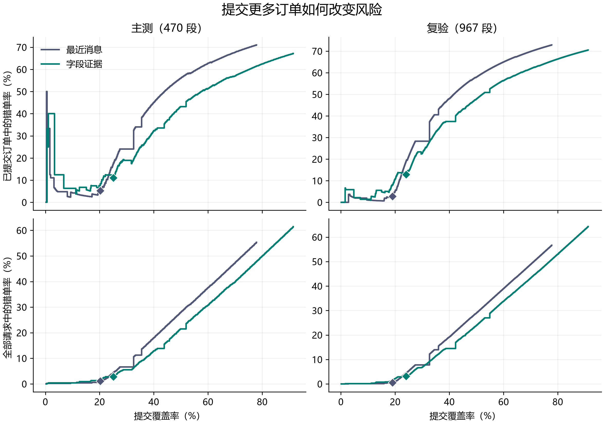

# 错单代价、覆盖率与座位字段证据

使用修正对话时序后的逐题预测。247 个开发对话参与阈值选择。两批评测的对话曾用于之前的探索。正确提交、未提交、错单的损失分别设为 0、1、λ，λ 取 2、5、10。这些权重为假设的业务偏好。阈值候选为 0.00 至 1.00（间隔 .05）和全部拒绝，在开发集选择损失最小的阈值。并列时先选错单少的阈值，再选较高阈值。

## 风险与提交覆盖率

曲线按整组置信度并列值移动阈值，菱形为开发集按 λ=5 选定的操作点。条件错单率以已提交订单为分母，总体错单率以全部请求为分母。零提交时条件风险无定义。

|批次|方法|正确|错单|提交 / 全部|条件错单率|总体错单率|
|---|---|---:|---:|---:|---:|---:|
|test|recent|93|7|100 / 470|7.00%|1.49%|
|test|field_support|106|21|127 / 470|16.54%|4.47%|
|replication|recent|186|11|197 / 967|5.58%|1.14%|
|replication|field_support|208|38|246 / 967|15.45%|3.93%|

上表取 .50 整单阈值。下表在开发集对每个方法、每项代价分别选择阈值。每请求损失差小于零表示字段选择损失较低。区间为基于对话的配对重采样 10,000 次，按每项单独计算。实际错单代价、有限开发集的阈值波动及模板相关性尚有额外不确定性。

|座位策略|λ|最近 / 字段阈值|主测每请求损失差 [95% 区间]|复验每请求损失差 [95% 区间]|
|---|---:|---:|---:|---:|
|raw|2|0.60 / 0.55|-0.015 [-0.043, +0.013]|+0.002 [-0.017, +0.021]|
|raw|5|0.60 / 0.55|+0.036 [-0.030, +0.104]|+0.080 [+0.033, +0.129]|
|raw|10|0.60 / 0.55|+0.121 [-0.013, +0.264]|+0.209 [+0.112, +0.315]|
|evidence|2|0.60 / 0.55|-0.028 [-0.049, -0.006]|-0.017 [-0.031, -0.002]|
|evidence|5|0.60 / 0.55|+0.004 [-0.040, +0.053]|+0.033 [-0.004, +0.072]|
|evidence|10|0.60 / 0.75|-0.019 [-0.091, +0.043]|-0.010 [-0.059, +0.033]|

## 阈值选择的不确定性

在 3,000 次重采样中分别抽取开发和评测对话。每次重新在开发样本选取阈值，然后到对应评测样本计算每请求损失差。两种方法共享每次抽取的对话。以下百分位区间含开发集阈值选择波动，仍假设对话独立，字段和整单模型权重保持固定。

|座位策略|λ|主测 95% 区间|复验 95% 区间|
|---|---:|---:|---:|
|raw|2|[-0.047, +0.021]|[-0.021, +0.033]|
|raw|5|[-0.040, +0.109]|[+0.004, +0.134]|
|raw|10|[-0.085, +0.257]|[-0.035, +0.313]|
|evidence|2|[-0.051, +0.009]|[-0.035, +0.018]|
|evidence|5|[-0.057, +0.094]|[-0.048, +0.111]|
|evidence|10|[-0.143, +0.211]|[-0.137, +0.236]|

各阈值及两臂阈值组合的入选频数见 [threshold-stability.json](threshold-stability.json)。

## 可选座位字段

两臂使用相同的座位规则。只有选中历史或当前用户话语含座位用词及待填值，或助手的座位提议与可见的紧邻用户肯定构成一对，才保留原拟填座位。否定、改口和隐含表达仍可能造成误判。整单阈值固定 .50。只提高座位分数阈值的消融在开发集选为 0.50。

|批次|方法|提交数|原正确 / 错单|门控正确 / 错单|座位多填（原 → 门控）|座位漏填（原 → 门控）|
|---|---|---:|---:|---:|---:|---:|
|test|recent|100|93 / 7|93 / 7|0 → 0|5 → 7|
|test|field_support|127|106 / 21|110 / 17|5 → 0|11 → 17|
|replication|recent|197|186 / 11|184 / 13|0 → 0|8 → 11|
|replication|field_support|246|208 / 38|215 / 31|12 → 0|19 → 27|

整单匹配使用官方参考。曲线和操作点用于离线比较，部署前仍需测量真实风险。

项目根目录可运行 python scripts/review_risk.py。开发选择见 [policy.json](policy.json)，逐阈值曲线见 [curve.json](curve.json)，全部计数及区间见 [results.json](results.json)。
